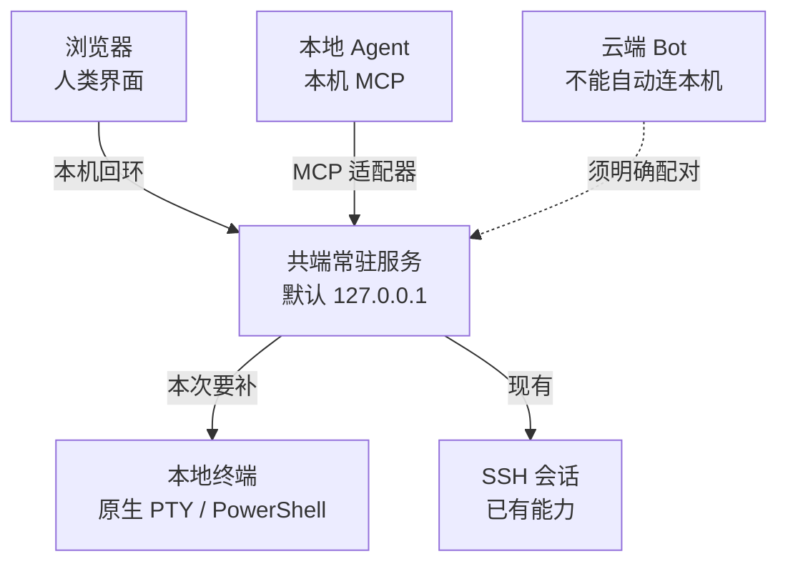
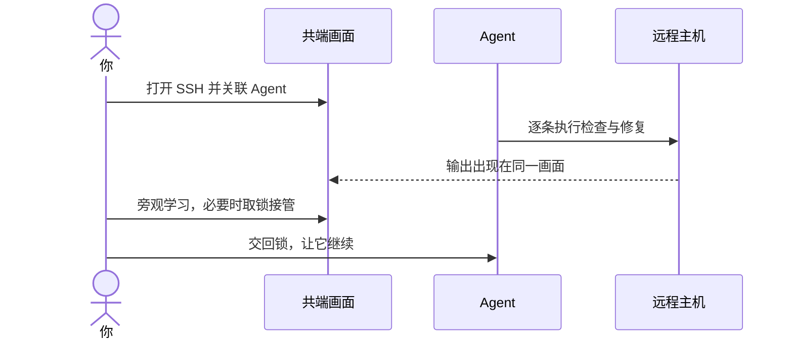

# 共端本地终端设计（提案）

> **文档状态：已定稿、尚未实施。** 这不是 `shared-ssh-terminal@0.7.0` 已实现的能力。
>
> 对照基线：公开仓库 [zhedream/shared-ssh-terminal](https://github.com/zhedream/shared-ssh-terminal) 的 `main` `2f0eab9`（包 `shared-ssh-terminal@0.7.0`）只有 SSH 共享会话。Windows 上可以跑共端服务，但共享的仍是 SSH，不是原生本机 shell。下文参数凡标「提案」的都是建议值，不是实测结果。
>
> 本文由已定稿设计页整理入库，供本地 T3「共端 · 经理」据此拆解任务并安排开发。

## 目录

- [定位与现状](#定位与现状)
- [原则与边界](#原则与边界)
- [推荐方案](#推荐方案)
- [Agent 何时选用共端](#agent-何时选用共端)
- [控制权与生命周期](#控制权与生命周期)
- [日志、可见与通知](#日志可见与通知)
- [界面应呈现的信息](#界面应呈现的信息)
- [两个典型流程](#两个典型流程)
- [状态、接口与异常](#状态接口与异常)
- [范围与验收](#范围与验收)
- [已确认的关键取舍](#已确认的关键取舍)

## 定位与现状

共端是人与 Agent 共用的一块真实终端：同一画面、同一套接管与隐私规则，用来共同查看、操作、接管和学习。它最早就是让 Agent 维护服务器，同时让你看到 AI 一步步执行了什么命令。本次要补的本地终端，是把同一理念拓到共端服务所在那台 PC 的原生 shell，不再绕 SSH 回环。

用户对本次需求的原话可以概括为：人启动的服务 Agent 看不见，Agent 启动的服务人不好接管。希望像 `npm run dev` 这类命令的画面和报错双方都能看，不用复制粘贴。

这不是把共端改定义成「长运行服务启动器」。`pnpm dev`、后端服务、watch 任务是首要场景，因为它们最常要共看报错和接管；但只要有共同查看、操作、接管或学习的目的，短命令也适合，比如演示一组操作、结对排错、看 Agent 怎么一步步排查。不需要共享的临时命令，仍留在各自的普通终端或 Agent 自己的执行环境。

**默认不用共端。** Agent 走正常执行环境；只有你确实要共同查看、操作、接管或学习时，才改走共端。不能仅凭命令是长运行服务，就自动选共端；也不能把共端设成所有执行的默认网关。

| 项目 | 说明 | 状态 |
| --- | --- | --- |
| 已有能力 | 本机常驻服务维护终端，浏览器是人类界面，MCP 适配器给本地 Agent。默认听 `127.0.0.1`，远程控制须明确配对。会话可关联一个 Agent，一个 Agent 可有多个会话。 | 0.7.0 已有 |
| 本次要补的 | Windows 原生 PTY / PowerShell，不要求 SSH 回环；与 SSH 共用同一套控制权、画面和隐私规则。Linux 用同一模型，放后续。 | 提案，尚未实施 |

「本机」只指共端常驻服务所在的那台 PC，例如公司电脑或日安 Acer，不是云端 Bot 的电脑。本地 MCP 只服务这台 PC 上的本地 Agent。云端 Bot 不会因为你的电脑装了本地 MCP，就自动连上这台机器。

## 原则与边界

- 默认不走共端：Agent 在自己的正常执行环境里工作；共端是共享意图出现时的选用通道，不是所有命令的默认网关。
- 以「这次是否要一起看、一起操作、接管或学习」为界，不以命令跑多久为界，也不以「是否长运行服务」自动改道。
- 同一会话、同一画面，没有另一份隐藏的原始日志。
- 本地与 SSH 沿用同一套锁、隐私、交还和 Agent 关联规则，不另起一套控制语义。
- 保持简单的共享终端，不做成进程编排平台，也不做成全量审计工具。
- 滚动历史最多 2000 行是保留边界：可被截断，服务重启后不恢复、不持久化。不可承诺逐条命令的永久记录，也不可承诺完整无限日志。
- 可见不等于主动通知，也不等于 Agent 被自动唤醒。
- 壳还活着不等于服务就绪；不解析提示符，不假称每条交互命令都能得到退出码。
- 不随意杀外部进程；你在外面 PowerShell 已经启动的服务，共端不能神奇读到它过去的历史。
- 本地终端不是沙盒，权限等于这台机器上的 Windows 用户；运行配置不写明文秘密。

## 推荐方案

首版在 Windows 上用原生 PTY（ConPTY）拉起 PowerShell 或指定命令，不要求先 SSH 连回本机。SSH 入口保留，两种会话类型共用同一套控制与画面规则。Linux 原生终端用同一模型，不放进首版。



三种打开方式都只是会话，不是三种产品。界面以会话列表为主，不要以「服务面板」做主视图，避免跑偏成启动管理器。

1. 打开一个本机 shell（可指定启动目录）。适合结对、演示、看 Agent 逐步执行。
2. 一次性跑一条命令并共享该终端。适合这次要一起看、但不必先写成配置的命令。
3. 用命名运行配置启动。适合反复要开的开发服务，如 `pnpm dev`。配置可复用，但不强迫所有命令都先包装成配置。

运行配置是便捷，不是门禁。它不表示「凡这类命令都必须走共端」。提案字段：名称、启动目录、命令、可选的非敏感环境变量、备注。**配置只保存在这台机器的共端服务里，绝不进项目仓库**（已确认：属于用户本机配置）。不写入密钥、token 或其他敏感值。

启动目录在本地和 SSH 两侧都支持，避免每次连上都要手敲 `cd`。

- 本地 PowerShell 或本地命令在拉起原生 PTY 时直接传入 `cwd` 作为初始工作目录；目录不存在则在启动前直接报错提示。
- SSH 连接配置与单次新建会话同样支持可选的启动目录（提案）：因为 OpenSSH 协议没有统一的初始目录字段，连接时由共端在远端切到该目录再进入交互 shell（不依赖 shell hook、不解析提示符）；若远端目录不存在，则留在默认登录目录并在画面提示，不中断连接。

防重复启动只针对「同一个运行配置已经被共端拉起且尚未退出」：并发请求原子地返回同一会话，不再拉起第二棵进程树。不能仅凭命令字符串或端口认定是同一服务；两个项目里都是 `pnpm dev`，仍是两件事。交互式空 shell 每次打开都是新会话，除非调用方带了去重用的 `start_key`（提案名称）。

## Agent 何时选用共端

这是给本地 Agent 的默认策略，必须写进产品和接口说明，不能只做成隐含习惯。共端 MCP 是「需要共享时才用的通道」，不是 Agent 跑命令的默认出口。

| 情况 | 怎么做 |
| --- | --- |
| 没有共享意图 | 走 Agent 自己的正常执行环境。即使命令是 `pnpm dev` 或其他长运行服务，也不自动改走共端。 |
| 你明确要共享 | 你说「在共端里开」「我要看你怎么做」「一起看报错」，或自己建了会话并关联该 Agent，这时才通过共端启动或加入。 |
| 共享意图已经落在某个会话 | 后续仍在这同一共享场景里继续，不必每条命令都再问一遍。例如已在共端里排 `pnpm dev` 的报错，接着看日志、重试或在同一 shell 里补一条命令，可直接继续。 |
| 新的、无共享意图的任务 | 回到默认：走正常执行环境。不要因为之前某个会话共享过，就把后面所有命令都塞进共端。 |
| 会话已关联但处于隐私模式 | Agent 不可看、不可操作，也不得另开一个共端会话来绕过隐私。 |

共享意图的判定应该是明确的，而不是猜测的。提案把下列视为已明确：你当面要求走共端；你在共端里建了会话并把该 Agent 关联上去；你把已有会话交给该 Agent 接管。单凭本机存在名为 `pnpm dev` 的运行配置，不够成为自动改道的理由。

若你只是说「帮我把前端跑起来」，没有说要一起看或在共端里开，Agent 应该在正常执行环境里启动。这时人仍可能看不见该终端——这是默认走法的取舍，不是缺陷。要共看、共管，就明确走一次共端。

## 控制权与生命周期

下表沿用现有 SSH 会话的控制权约定，并补本地进程树的停止与删除区别。独占输入锁：普通状态下 Agent 可从用户手中接管；隐私模式下 Agent 不可看、不可操作；Agent 显式交还给你之后，不可再抢回，须你显式交回。

| 操作 | 谁可以做 | 对进程 | 对会话与画面 |
| --- | --- | --- | --- |
| 创建 / 启动 | 你；或已有明确共享意图的本地 Agent | 拉起新的进程树，或加入已有会话 | 新建或复用会话，同源共享画面 |
| 观察 | 你；普通模式下已关联的 Agent | 不影响 | 同源最多 2000 行，无隐藏日志 |
| 取锁 | 你随时可以；普通模式下 Agent 可从你手中接管，除非它已显式交还 | 不影响 | 锁持有者变更 |
| 输入 / Ctrl+C | 仅锁持有者 | Ctrl+C 送到该会话 PTY | 按终端回显 |
| 重启 | 你；持锁 Agent（提案） | 先停进程树，再按同一配置或同一命令拉起 | 同一会话对象，画面清空并标出一次重启（提案） |
| 关闭网页 | 任何人关自己的浏览器 | 不终止 | 会话仍留在共端服务里，再打开可继续看 |
| 停止会话 | 你始终可以；持锁 Agent 可请求优雅停止 | 停止共端拉起并跟踪的进程树 | 会话记录保留，状态变为已停止或已退出，画面保留已有滚动历史 |
| 删除会话 | 你；Agent 默认只能停止、不能删除（提案） | 若仍在运行则先停止 | 记录移除，输出丢弃 |

停止顺序（提案）：先向该会话 PTY 发送 Ctrl+C，等待 8 秒；若进程树仍在，再强杀共端记录的根进程及其子进程。只杀共端拉起并跟踪的那棵树，不按端口杀，不扫全机同名进程。强杀要在会话画面里留下明确标记。外部已经在跑的进程，首版不接管、不自动杀。

你始终可以停止、强杀和删除这台共端上的会话。持锁 Agent 可输入、发 Ctrl+C、请求优雅停止与重启；优雅停止超时（提案 8 秒）后允许强杀共端拉起的该进程树，并在画面留下记录。

共端服务自身重启后，本地会话与现有 SSH 一致：丢失且不自动恢复，输出不持久化。运行配置依然保留，可由你或 Agent 在已有共享意图时再次启动。首版不做会话脱离（让进程继续跑但共端不再看管），避免留下无人看管的孤儿进程。

## 日志、可见与通知

学习和排错都发生在这块真实终端上，不另做一份「Agent 操作审计流」。人与 Agent 看到的是同源画面。滚动历史最多 2000 行（已有约束）；超出后旧输出丢弃，画面上要有截断提示。MCP 按游标增量读取（提案），游标之前若已被截断，读取结果应明说，不得把剩余缓冲装成完整历史。

首版明确不承诺：完整无限日志；PTY 里稳定区分 stderr；自动、正确识别编译报错；逐条命令的永久记录或可搜索的操作史。PTY 是单一字节流，画面上能看到报错文本，但系统不保证把它归类成「编译错误」。

可见、主动通知、Agent 自动唤醒是三件事。报错出现在共享画面上，并不会在首版把 Agent 叫醒。Agent 只在处理当前任务时去查看已关联的会话。订阅或主动唤醒列为后续，且需要宿主环境支持。

隐私切换与清空对浏览器和 MCP 一致：开启隐私后 Agent 读不到画面、也操作不了；清空后，后续读取不得再看到已清掉的内容。不把 shell 当沙盒，也不在可被列出的配置里存敏感环境变量。

## 界面应呈现的信息

下面是信息结构说明，不是真实产品界面的模仿。主视图是会话列表加一块共享终端画面，运行配置是次要入口。

| 界面元素 | 应呈现的信息 |
| --- | --- |
| 会话列表 | 名称、类型（本地 / SSH）、目录、命令或 shell、进程状态、锁持有者、隐私、关联 Agent、是否已截断 |
| 会话顶栏 | 上述同一组信息，加取锁、交还、隐私、停止、重启、删除 |
| 主画面 | 与 Agent 同源的终端画面，最多 2000 行，含截断或重启标记 |
| 进程状态用词 | 启动中 / 运行中（PTY 存活）/ 停止中 / 已退出 / 已停止 / 已丢失。不写「就绪」 |
| 运行配置 | 本机上的简单列表（不进仓库）：名称、启动目录、命令、备注；SSH 服务器配置同样支持可选启动目录。用来开始一次共享，不是服务编排台 |
| 冲突提示 | 若偶然发现端口被占，可提示，但不承诺全局扫描，也不因此自动结束外部进程 |

## 两个典型流程

前两个是定位场景：一个说明共端为什么存在，一个说明本次要补的本地能力。再对照「你先开」和「Agent 先开」。

### 服务器维护与学习

你要看 Agent 怎么检修远程机，于是把 SSH 会话关联给它。这是共端的原始场景，控制权规则不变。Agent 不会因为「在维护服务器」就把所有本机临时命令也塞进这个会话。



### 本机开发：你先开

你要和 Agent 一起看本机前端的报错，于是明确在共端里启动。若你只是自己在普通终端里跑 `pnpm dev`，并没要求共享，Agent 不会自动把它接进共端，也读不到那份外部历史。

1. **你在共端里开本地会话**：可直接开 shell，也可用命名配置跑 `pnpm dev`。
2. **把会话关联给本地 Agent**：这就落定了共享意图。后续它在这份排错里可继续读同一画面，不用每条命令再问。
3. **双方看同一份输出**：编译报错直接出现在画面上，不用复制粘贴。Agent 在处理任务时自己去读，首版不会被报错自动唤醒。
4. **你可随时取锁接管**：输入或 Ctrl+C。若 Agent 已经把锁交还给你，它不能自己抢回。
5. **关掉网页不会停掉进程**：再打开还能看到同一画面（服务未重启前，且以 2000 行为限）。

### 本机开发：Agent 先开

你明确说「在共端里把前端跑起来，我要看报错」。Agent 先查已有会话和配置，没有运行中的同一配置再启动，并把会话交给你看。若你只说「把前端跑起来」而没有共享意图，它应走正常执行环境，不要自动改走共端。

1. **确认共享意图已经明确**：你的指示里要求走共端，或这是已经展开的同一共享任务。
2. **先查再启**：列出会话与运行配置。同一配置已在跑，就加入，不再拉一份。并发启动只产生一棵进程树。
3. **你在浏览器里看到同一画面**：可以取锁接管。Agent 处理任务期间按游标读输出，不用你贴报错。
4. **Agent 交还锁之后**：它不能再抢回，要等你显式交回。
5. **任务结束后的新请求**：若没有新的共享意图，回到正常执行环境，不要把后续临时命令都留在共端里。

## 状态、接口与异常

### 会话状态

| 状态 | 含义 | 不是什么 |
| --- | --- | --- |
| 启动中 | 正在创建 PTY 与进程 | 还不能当作已经跑起来 |
| 运行中 | PTY 存活，进程树还在 | 不等于服务就绪，也不等于编译已通过 |
| 停止中 | 已发出停止，正在等待或强杀 | 不是已经清理完毕 |
| 已退出 | 根进程自己结束；有则带上退出码 | 不是每一条已执行过的交互命令都有退出码 |
| 已停止 | 共端已把进程树停掉 | 会话记录还在，直到删除或服务重启 |
| 已丢失 | 共端服务重启后会话不在了 | 不会自动拉起，输出也不会回来 |

### 接口提案

下列为提案接口名，不是现有实现的函数名。观察与控制复用现有 SSH 会话已经给 Agent 的能力：列会话、读输出、取锁与交还、写入、隐私与清空、关联 Agent。本地会话走同一套能力。新增仅针对本地启停。

```text
# 复用现有会话能力（本地与 SSH 共用，名称为提案）
list_sessions
read_output(session_id, cursor?)
take_lock / release_lock / handoff
write_input
set_privacy / clear_output
bind_agent

# 新增（提案命名）
list_run_configs()
open_local_shell({ cwd?, start_key? })
start_run({ config_id } | { cwd, command, name?, start_key? })  # 对 config_id 幂等
stop_session(session_id, { mode: "graceful" | "force" })
restart_session(session_id)
# SSH 配置与新建会话同样支持可选启动目录 startup_dir?（提案）

# 选用约定（写进 Agent 说明，不是另一个 API）
# 默认不调用上述启动接口；仅当共享意图明确，
# 或已落在同一共享会话中时才用。
```

### 异常与边界

- 外部 PowerShell 里已经在跑的服务：读不到历史，首版不接管。若偶然发现端口冲突可提示，不承诺复杂全局扫描，也不自动杀它。
- 两个 Agent 同时按同一配置启动：只产生一个会话、一棵进程树，双方拿到同一会话标识。
- 优雅停止后子进程仍占端口：走强杀进程树，仍不按端口去杀外部进程。
- 共端服务崩溃或重启：会话进入已丢失，不自动拉起，输出清空。
- 云端 Bot 请求本地终端：默认不可达。没有明确配对，就不得连。
- 隐私模式下的读写请求：拒绝，且不泄露画面内容。
- 已交还锁的 Agent 再取锁：拒绝，直到你显式交回。

## 范围与验收

### 首版

- Windows 原生本地终端（PTY / PowerShell），无需 SSH 回环
- 与 SSH 双入口并存，同一套锁、隐私、交还、关联规则
- 可开本机 shell、一次性共享命令、或用命名运行配置；配置仅存本机不进仓库，可复用但不强制
- 本地终端与 SSH 连接配置均支持可选启动目录，打开即位于目标目录，减少重复 `cd`
- 对运行配置的幂等启动与并发原子创建
- 停止共端拉起的 Windows 进程树；强杀留标记
- 同源 2000 行画面、截断提示、游标增量读取
- 关闭网页不终止会话；服务重启后会话丢失且不自动恢复
- Agent 默认走正常执行环境；仅在共享意图明确时使用共端，并可在已有会话中继续而不逐条询问
- 外部已启动进程不接管；端口冲突只作提示
- 首版不做就绪探测、不做订阅唤醒、不做 Linux 原生终端

### 后续

- Linux 原生本地终端，同一控制模型
- 可选的就绪探测（HTTP 或日志模式），仍不与「PTY 存活」混用
- 输出订阅或 Agent 主动唤醒，前提是宿主环境能支持
- 服务重启后按标记恢复某些本地会话，需另行审议
- 更完整的端口冲突提示，仍不自动杀外部进程

### 不做

- 把共端变成所有 Agent 命令的默认网关
- 仅凭命令是长运行服务就自动改走共端
- 把共端做成进程编排平台或服务监控台
- 做全量命令审计、逐条永久记录或可搜索的操作史
- 把用户本机的运行配置写进项目仓库
- 假称完整无限日志、稳定区分 stderr、自动识别编译报错
- 解析提示符，或为仍在跑的交互 shell 伪造每条命令退出码
- 首版接管外部已启动的终端，或按端口杀外部进程
- 仅因本地 MCP 就让云端 Bot 连到用户的 PC
- 把本地终端当成沙盒

### 可执行的验收用例

1. 在 Windows 上不经 SSH 回环打开本地会话，浏览器与本地 Agent 看到同一画面的最近输出。
2. 你只说「把前端跑起来」、没有共享意图时，Agent 不走共端，即使命令是 `pnpm dev`，也不新建共端会话。
3. 你明确要求在共端里启动后，Agent 才通过共端拉起；同一配置若已在跑，则加入而不再启一份。
4. 已经落在同一共享会话后，Agent 继续读日志或在该 shell 里补一条命令时，不再逐条询问是否走共端。
5. 新的无共享意图任务（如另一个项目的临时查看）回到正常执行环境，不塞进之前的共端会话。
6. 不经运行配置打开本机 shell，双方按同一套锁与隐私规则共同查看并输入若干条短命令。
7. SSH 维护学习场景下，你能看到 Agent 逐条命令与输出，可取锁接管；交还后 Agent 不能抢锁。
8. 两个调用方并发启动同一运行配置，只有一棵进程树，双方得到同一会话。
9. 关闭网页后进程与会话仍在；再打开能看到同一画面（服务未重启、未超过 2000 行）。
10. 停止会话会收掉共端拉起的子进程；不会杀掉一个共端没有拉起、只是端口巧合的外部进程。
11. 外部 PowerShell 已在跑的 `pnpm dev`：共端读不到它的历史，首版不接管，也不自动结束它。
12. 开启隐私后 Agent 读不到、操作不了；清空后，后续读取看不到已清内容。
13. PTY 仍在时，界面和接口都只报「运行中」，不称服务就绪，也不为仍在交互的 shell 伪造每条命令退出码。
14. 输出超过 2000 行后出现截断提示；按旧游标读取时，若历史已丢，结果明确说明，不装成完整记录。
15. 共端服务重启后会话丢失、输出不在，运行配置仍在，且不会自动拉起。
16. 云端 Bot 不能仅因本地 MCP 就连到这台 PC 上的本地终端。
17. 本地 PowerShell 按启动目录打开后直接处于该目录，不额外发送 `cd`；SSH 配置启动目录后连上即进入目标目录，目录不存在时留在默认目录并提示。

### 验收与分工

- **本地 T3 团队（Windows 环境）**负责本设计的开发，以及首版全部 Windows 相关验收（含原生 PTY / PowerShell、运行配置、启动目录、进程树停止与强杀、锁与隐私、幂等启动等）。
- **总经理侧（Linux 环境）**承接 Linux 相关测试，包括现有 Linux 回环/兼容性回归，以及后续 Linux 原生终端验证。本地团队达到可测节点时，将分支、提交与验收关注点告知总经理侧即可，不必自行搭建 Linux 验收环境。
- 首版范围本身不含 Linux 原生本地终端；但涉及共享控制规则、SSH 启动目录等跨平台行为时，Linux 侧回归仍由总经理侧承接。

## 已确认的关键取舍

以下首版边界与安全取舍均已定稿：

1. **运行配置仅存本机、不进仓库**：属于用户本机配置，避免把本机路径写进项目 git。
2. **本地 PowerShell 与 SSH 均支持可选启动目录**：本地直接传 `cwd`，SSH 连上切目录，不存在时留在默认目录并提示。
3. **Agent 强杀权限**：持锁 Agent 可请求优雅停止；超时（提案 8 秒）后可强杀「共端拉起的该进程树」，并在画面留下记录，不按端口杀外部进程。
4. **共端服务重启后不自动拉起本地会话**：首版与 SSH 一致，不自动恢复，运行配置保留，由你或 Agent 在仍有共享意图时手动再开。
